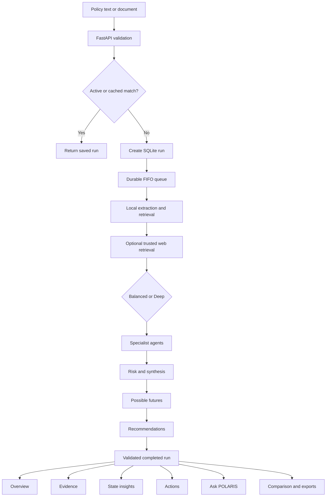

# POLARIS — Policy intelligence studio

POLARIS is a local research workspace for Indian public policy. Submit a policy or document, inspect specialist assessments and their evidence, ask follow-up questions, and explore changed assumptions. React/TypeScript and TanStack Start power the interface; FastAPI, SQLite, local retrieval, trusted-domain web retrieval, and Groq power the backend.

## What's included

- **Balanced and Deep analysis.** Balanced combines four specialist perspectives into one assessment call, risk/synthesis into another, grounded possible futures into a third, and recommendations into a fourth: **4 planned model calls instead of Deep's 8**. Document parsing runs locally. Scenario and recommendation inputs are compacted from completed findings to remain within the safe request ceiling. Validation repairs and provider retries can still add calls.
- **A shared, durable queue.** Policy analysis, Ask POLARIS, and scenario-lab jobs share a single FIFO worker and the same shared request/token pacing. Queued positions, started/finished timestamps, stage states, and provider wait deadlines come from the backend.
- **Partial results and cancellation.** Validated findings are saved after each stage, including scenarios and recommendations. Cancel queued or running work without deleting completed findings. A late response cannot overwrite a cancelled job. Work interrupted by a backend restart resumes valid saved checkpoints. An already dispatched provider request may still consume quota when cancelled.
- **Recent-result reuse.** Exact matching input, domain, model configuration, analysis mode, and evidence setting reuse active work or a recent completed run. Defaults are one hour with web research and 24 hours with document evidence only. The analysis-code revision is part of the cache key. Refresh bypasses a completed cache hit, but never duplicates an active request.
- **A responsive workspace.** Desktop sidebar and mobile navigation, light/dark themes, editable illustrative proposals, input/upload tabs, drag-and-drop, file validation, automatic local drafts, history search, and readable empty/error states.
- **Six-section Quick summary.** What the policy does; likely benefits; tradeoffs and risks; who is affected; uncertainty; recommended actions. Analyst detail exposes metrics, reasoning summaries, source excerpts, geographic estimates, and recommendations. Switching views uses the same saved results and makes no model request. Reading preference is saved locally.
- **Claim-level evidence drawer.** Important findings expose View evidence. New outputs reference stable document/source IDs. References are checked against the catalog actually sent to that model call, including after prompt compaction and repair. The drawer shows linked excerpts, source URLs, recorded metadata, assumptions, uncertainty, and explicitly linked conflicting evidence. Unlinked findings say so. IDs establish traceability, not proof.
- **Ask POLARIS.** A floating accessible dialog with saved, separate conversation histories for each run. Answers use bounded follow-up context, completed findings, and supplied evidence. Partial answers are labeled. Sending, queued/waiting, retry, and cancellation states are real; responses are not simulated streaming. Minimize and reopen without losing saved messages.
- **Possible futures.** The core pipeline generates three policy-specific, evidence-linked scenarios with differentiated mechanisms, outcome points, qualitative likelihoods, and likelihood rationales. The current interface has no What-if tab.
- **Comparison and exports.** Compare two saved completed policies without model calls. Download text, JSON, and CSV reports or copy a report. CSV exports neutralize spreadsheet formulas in untrusted text.
- **Background navigation.** Continue browsing keeps backend work running. A persistent in-app indicator reopens the tracked analysis; completion/failure notifications link to saved findings. The selected run survives refresh through `?run=...` and session storage.

## Run locally

Requirements: Node.js compatible with Vite 8 (the workspace was checked with Node 24), Python 3.11+, and a Groq API key.

```powershell
npm install
python -m pip install -r backend/requirements.txt
Copy-Item backend/.env.example backend/.env
```

Fill in `GROQ_API_KEY` in `backend/.env`. Preserve your existing configuration if that file already exists. ScrapingBee is optional; public retrieval works without it where sources allow access.

```powershell
powershell -ExecutionPolicy Bypass -File .\start-polaris.ps1
```

Frontend: http://127.0.0.1:8080  
Backend: http://127.0.0.1:8001  
API documentation: http://127.0.0.1:8001/docs

The startup script reuses already-running services. Restart an existing backend after changing Python code. A backend instance guard prevents accidentally running two independent local quota consumers.

Use `VITE_API_BASE_URL` when the frontend and backend are on different origins. API credentials remain in the backend and are never returned by the runtime endpoint.

## Quota protection

Existing token limits and environment overrides are retained. Default guardrails:

| Setting                         | Default | Purpose                                       |
| ------------------------------- | ------- | --------------------------------------------- |
| `GROQ_TOKENS_PER_MINUTE`        | 8000    | Configured provider token budget              |
| `GROQ_TPM_SAFETY_RATIO`         | 0.70    | Reserve tokenizer headroom                    |
| `GROQ_TOKEN_WINDOW_SECONDS`     | 65      | Conservative rolling window                   |
| `GROQ_MAX_REQUEST_TOKENS`       | 5500    | Estimated input plus maximum output ceiling   |
| `GROQ_REQUESTS_PER_MINUTE`      | 30      | Shared request pacing                         |
| `GROQ_REQUEST_SPACING`          | 0.75    | Minimum configured inter-call spacing         |
| `GROQ_BYTES_PER_TOKEN_ESTIMATE` | 2.0     | UTF-8 based conservative estimate             |
| `GROQ_TOKEN_BUDGET_SCOPE`       | shared  | Default account budget across model fallbacks |

The system serializes jobs and model calls, honors provider reset information and Retry-After, compacts repeated/secondary prompt content, and reconciles reserved tokens against returned usage. Long policy text is sampled across the document; the full document remains in SQLite/local retrieval. A request that cannot fit the configured ceiling fails locally rather than sending an oversized request.

Groq's remaining-request header refers to the daily request limit; token headers refer to the per-minute token limit. A non-exhausted daily reset is not treated as a mandatory pause. See [Groq's rate-limit documentation](https://console.groq.com/docs/rate-limits).

Quota telemetry in Preferences & system shows **local reservations**, not a provider account balance. API limits imposed by other applications sharing your account can still delay work.

Optional cache settings can shorten or disable reuse:

```env
POLARIS_WEB_CACHE_TTL_SECONDS=3600
POLARIS_DOCUMENT_CACHE_TTL_SECONDS=86400
```

Chat and scenario analysis each have one planned call, plus bounded validation/provider retries. Merely opening chat, moving assumption controls, browsing history, switching summary/detail, comparing runs, or exporting reports makes no Groq calls.

## Evidence and analytical quality

New synthesis output includes a `brief` with six keys:

```json
{
  "policy": [],
  "benefits": [],
  "risks": [],
  "affected": [],
  "uncertainty": [],
  "actions": []
}
```

Each section contains concise claims:

```json
{
  "text": "A policy-specific finding",
  "kind": "ai_inference",
  "evidence_ids": ["doc-..."],
  "assumptions": [],
  "uncertainty": "What the available evidence does not establish",
  "conflicting_evidence_ids": []
}
```

Kinds distinguish document facts, external evidence, AI inferences, and user assumptions. Model classification is not independent fact verification. Invalid IDs are removed, not replaced by guessed sources. Model inputs treat policy text, external excerpts, prior responses, and user assumptions as untrusted data rather than instructions.

Metadata is shown only when actually available. Plain text/PDF extraction currently does not retain original document pagination; passage IDs are retrieval identifiers, not invented page numbers. Web publication dates appear only when provided in supported source metadata. A blocked or unreadable page remains a link-only reference and is not supplied as page-content evidence.

Older runs remain readable. They do not receive fabricated citations, new brief sections, or recommendations. Any later chat on an older run can cite the specific catalog supplied to that chat; this does not retroactively attach those citations to the original analysis.

Impact values are **0–100 magnitude indices**, not benefit percentages. A score of 1 stays 1/100. Confidence is model-assessed evidence support, not measured accuracy. Aggregate confidence is the arithmetic mean of four domain confidences and risk confidence. Scenario likelihoods must be finite, individually between 5 and 90, have rationales, and total 100; only minor rounding discrepancies are normalized.

## Persistence and API

The existing `backend/polaris.db` is preserved. Schema changes add a cache-key column/index; no history is dropped or rewritten. Chat/scenario jobs use the existing durable job storage, keyed by parent run and job kind, and are excluded from the main policy library. Completed checkpoints are saved with each policy.

| Method     | Endpoint                       | Behavior                                                     |
| ---------- | ------------------------------ | ------------------------------------------------------------ |
| GET        | `/api/health`                  | Service health                                               |
| GET        | `/api/runtime`                 | Safe queue, quota configuration, cache, and mode metadata    |
| POST       | `/api/runs`                    | Submit policy text or reuse an identical run                 |
| POST       | `/api/runs/upload`             | Extract and submit a document                                |
| GET        | `/api/runs?limit=100&offset=0` | Policy history without full policy text                      |
| GET        | `/api/runs/{id}`               | Saved findings, stages, evidence, and current queue position |
| POST       | `/api/runs/{id}/cancel`        | Cancel while preserving partial findings                     |
| GET / POST | `/api/runs/{id}/chat`          | List saved chat exchanges / queue a question                 |
| GET / POST | `/api/runs/{id}/scenarios`     | List variants / queue assumption reanalysis                  |
| GET        | `/api/jobs/{id}`               | Inspect a chat or scenario job                               |
| POST       | `/api/jobs/{id}/cancel`        | Cancel a chat/scenario job                                   |
| POST       | `/api/jobs/{id}/retry`         | Retry a failed/cancelled chat/scenario job                   |
| PATCH      | `/api/scenarios/{id}`          | Rename a variant                                             |
| DELETE     | `/api/scenarios/{id}`          | Cancel if necessary and delete a variant                     |

Create an analysis:

```json
{
  "policy_text": "Your policy proposal",
  "domain_hint": null,
  "web_enabled": true,
  "analysis_mode": "balanced",
  "force_refresh": false
}
```

Response includes `run_id`, `reused`, `reuse_reason` (active/cached/null), and `queue_position`. Position 0 is active; positive positions are queued; null means no live queue entry. Upload accepts the same options as multipart fields.

Chat POST: `{ "question": "...", "request_id": "client-generated-UUID" }`.  
Scenario POST: `{ "title": "...", "assumptions": {"Funding adequacy": "Funding constrained"}, "notes": "...", "request_id": "client-generated-UUID" }`.  
Rename PATCH: `{ "title": "New variant name" }`.

Request IDs make retries idempotent. One active chat reply per policy prevents accidental overlapping follow-ups. HTTP errors return readable details to the frontend.

## Checks

```powershell
python -m pip install -r backend/requirements-dev.txt
npm run typecheck
npm run lint
npm test
npm run build
```

The backend tests use temporary databases and mocked providers. They cover quota pacing, bounded requests, 4/8-call modes, local document parsing, immediate stage persistence, checkpoint recovery, cache separation and expiry, cancellation, source-ID validation, scenario validation, and workspace persistence.

The frontend test renders seven run states plus partial findings and old analyses using React server rendering. It checks six-section summaries, safe exports, citation identifiers, and initial input controls. This is not a substitute for interactive browser/accessibility testing.

Groq is the only supported model provider. Browser automation may still be needed for a full visual and accessibility QA pass.

## Remaining limits

- This is a local/shared workspace without authentication or per-user authorization. Do not expose the backend publicly as a multi-tenant service.
- Geographic weights still use illustrative, unsourced seed data. They are clearly labeled heuristic exposure, not empirical state effects. The bundled atlas has 36 regions, separate Telangana, Jammu and Kashmir, and Ladakh. It follows an Indian claimed-boundary depiction; disputed areas are labeled. Source provenance is in `src/data/india-map-sources.md`.
- Retrieval is lightweight keyword-based RAG, not a calibrated economic/legal model. Source allowlisting and valid citation IDs do not prove factual correctness.
- Uploaded files must be PDF, DOCX, TXT, MD, CSV, or JSON, at most 10 MB, with no more than 200,000 extracted characters. Scanned PDFs need OCR before upload.
- Chat can still wait behind the current analysis or the provider's quota window. Possible futures and state dossiers use compact, bounded Groq requests.
- The comparison picker currently loads up to 500 recent analyses. Use Load more analyses in the policy library, or the history API's pagination, for older records.
- A client draft is stored locally; files must be selected again after refreshing the input form. Saved runs and conversations live in the backend, not in browser storage.

## Main implementation files

Backend: `main.py`, `run_manager.py`, `db.py`, `run_cache.py`, `pipeline.py`, `groq_client.py`, `evidence.py`, `workspace.py`, `json_util.py`, and `web_retriever.py`.

Frontend: `src/routes/index.tsx`, `src/lib/polaris-api.ts`, and the POLARIS components: PolicyForm, RunProgress, DetailedDashboard, QuickSummary, EvidenceDrawer, AskPolaris, ScenarioLab, ComparisonWorkspace, RunHistory, Sidebar, TopBar, and SettingsPanel.

The Lovable integration rule still applies: do not rewrite published Git history. No deployment or push is needed to run this workspace locally.

The `Resume analysis` button calls `POST /api/runs/{run_id}/resume` for failed or cancelled analyses. Saved successful checkpoints are reused. Validation repair avoids duplicating the system instructions and discards an invalid prior completion when necessary to fit the unchanged 5,500-token ceiling, preserving the grounding context instead. Balanced synthesis explicitly includes the six-section brief in its output schema.

### Regional explorer

The atlas offers keyboard-selectable regions, flat/3D-style relief, zoom/reset, search, domain weights, saved source mentions, and national domain context. Selection and browsing make no model calls. `Generate state dossier` queues a bounded, source-grounded follow-up through the existing worker; stable request IDs reuse each state's saved answer. Dossiers distinguish regional evidence from national inference and cover rural/urban eligibility, affected groups, implementation risks, actions, and monitoring gaps. They do not fetch new regional statistics or claim to be empirical state forecasts.

---

## Architecture handbook

### Request-to-result topology



### Pipeline stage matrix

| Stage           | Input                         | Processing                                | Saved output              | Failure behavior            |
| --------------- | ----------------------------- | ----------------------------------------- | ------------------------- | --------------------------- |
| Submission      | Text or multipart file        | Validate, normalize, calculate cache key  | Initial run               | Readable HTTP error         |
| Parsing         | Compacted policy              | Structured classification                 | `parsed_policy`           | Run stops safely            |
| Retrieval       | Full saved policy             | Chunk scoring and optional web retrieval  | Context, sources, catalog | Local context remains       |
| Specialists     | Scope and evidence            | Combined Balanced or four Deep calls      | Four domain outputs       | Valid checkpoints remain    |
| Risk            | Specialist signals            | Structured risk assessment                | Risk output               | Domain results remain       |
| Synthesis       | Domain and risk outputs       | Verdict and six-section brief             | `synthesis`               | Earlier work remains        |
| Scenarios       | Findings, risk, evidence      | Groq possible-future generation           | `scenario_set`            | Resume reruns missing stage |
| Recommendations | Findings, scenarios, evidence | Groq action generation                    | `recommendations`         | Resume reruns missing stage |
| Completion      | Validated outputs             | Regional aggregation and lifecycle update | Final run                 | Terminal state persists     |

### Frontend state flow

TanStack Query owns remote state. The root route polls runtime metadata every 15 seconds and active runs more frequently while needed. Terminal runs stop polling. The selected run is synchronized to the URL and session storage. A separately tracked active run enables background browsing and completion notifications.

`src/lib/polaris-api.ts` contains typed run, agent, evidence, scenario, recommendation, runtime, and workspace-job contracts. It also owns API-base resolution, JSON and multipart transport, network errors, status helpers, and all frontend endpoint functions.

### Backend execution flow

`backend/main.py` owns HTTP concerns, `RunManager` owns scheduling, `pipeline.py` owns core analysis, and `workspace.py` owns follow-up jobs. Submission returns immediately after the run is committed and queued. The browser polls the saved representation, so page refresh and navigation do not control job lifetime.

### Structured-output contract

Every analytical model response is JSON. A traced claim has this shape:

```json
{
  "text": "Policy-specific conclusion",
  "kind": "ai_inference",
  "evidence_ids": ["doc-123"],
  "assumptions": [],
  "uncertainty": "What the supplied material does not establish",
  "conflicting_evidence_ids": []
}
```

The six-section brief always uses `policy`, `benefits`, `risks`, `affected`, `uncertainty`, and `actions`.

Specialists can return reasoning, metric effects, direction, magnitude, confidence, evidence, assumptions, uncertainty, and affected-state weights. Raw metric identifiers are never substituted for complete recommendations.

### Scenario and recommendation integrity

Possible futures are generated during the core pipeline from the real saved policy, specialist findings, risk, and evidence. Validation requires differentiated content, outcome points, likelihoods, and rationales. The visible product has no What-if tab; compatibility routes remain only for older saved job data.

Recommendations run after the earlier analysis is available. Validation requires at least three substantive policy-specific actions with a title, description, reason, priority, supporting signals, and trace fields.

### Regional boundaries

Map selection and browsing are local. Values represent relative model weights, not measured impact. A state dossier sends one compact request containing the selected state, two goals, saved domain weights, a small metric set, risk context, and at most two passages that name the state. Its answer must contain exactly five short points: Exposure, Likely effect, Main risk, State action, and Data needed.

### Reliability layers

1. Pydantic validates inbound requests.
2. File and policy limits reject invalid inputs early.
3. Cache keys prevent redundant work.
4. A submission lock blocks duplicate scheduling.
5. A backend instance guard prevents two local quota consumers.
6. One FIFO worker serializes provider work.
7. Token reservations and pacing protect rate limits.
8. Prompt compaction bounds requests.
9. Normalizers handle safe representation differences.
10. Validators reject incomplete output.
11. Citation filters remove unknown source IDs.
12. Stage checkpoints preserve completed work.
13. Terminal-state guards block late writes.
14. Startup recovery re-enqueues unfinished jobs.
15. Partial UI states keep saved results readable.

## Complete module catalog

### Product UI

| File                                   | Role                                                       |
| -------------------------------------- | ---------------------------------------------------------- |
| `PolicyForm.tsx`                       | Submission, uploads, examples, modes, drafts, validation   |
| `RunProgress.tsx`                      | Six-section progress, queue, timings, tokens, cancellation |
| `DetailedDashboard.tsx`                | Overview, Evidence, State insights, Actions                |
| `QuickSummary.tsx`                     | Six-section executive reading mode                         |
| `KpiHeader.tsx`                        | Impact, risk, confidence                                   |
| `EvidenceDrawer.tsx`                   | Sources, assumptions, uncertainty, conflicts               |
| `IndiaMap.tsx`                         | GeoJSON, selection, keyboard control, zoom, relief         |
| `StateInsights.tsx`                    | State search, weights, context, dossiers                   |
| `AskPolaris.tsx`                       | Follow-up chat, persistence, retry, cancel                 |
| `RunHistory.tsx`                       | Search, pagination, status, reopening                      |
| `ComparisonWorkspace.tsx`              | Two-policy saved-result comparison                         |
| `Sidebar.tsx` and `TopBar.tsx`         | Navigation, connection, responsive theme                   |
| `SettingsPanel.tsx`                    | Safe provider, queue, cache, and quota visibility          |
| `JobStatus.tsx`                        | Workspace-job progress                                     |
| `AgentPanel.tsx` and `VerdictCard.tsx` | Reusable result summaries                                  |

### Frontend libraries

| File                                   | Role                                                      |
| -------------------------------------- | --------------------------------------------------------- |
| `polaris-api.ts`                       | API contracts and transport                               |
| `brief-sections.ts`                    | Canonical brief ordering                                  |
| `report-export.ts`                     | Text, JSON, safe CSV                                      |
| `state-geography.ts`                   | State aliases and normalization                           |
| `policy-templates.ts`                  | Editable illustrative examples                            |
| `error-capture.ts` and `error-page.ts` | Bounded error handling                                    |
| `styles.css`                           | Glass design system, themes, depth, motion, accessibility |

### Backend services

| File               | Role                                         |
| ------------------ | -------------------------------------------- |
| `main.py`          | FastAPI lifecycle, uploads, policy endpoints |
| `models.py`        | Pydantic contracts, statuses, limits         |
| `pipeline.py`      | Multi-stage analysis                         |
| `groq_client.py`   | Groq transport, fallback, retry, quota       |
| `prompts.py`       | Active agent instructions                    |
| `json_util.py`     | Output normalization                         |
| `evidence.py`      | Catalog and citation rules                   |
| `rag.py`           | Chunking, retrieval, compaction              |
| `web_retriever.py` | Trusted-source retrieval                     |
| `run_manager.py`   | Durable FIFO, cancel, recovery               |
| `run_cache.py`     | Cache revision, keys, TTL                    |
| `workspace.py`     | Chat, dossier, compatibility jobs            |
| `db.py`            | SQLite and atomic updates                    |
| `worldbank.py`     | Supporting public-indicator helpers          |

## Operations guide

### Local data that must stay untracked

- `backend/.env` and `backend/.env.local`
- `backend/polaris.db`
- `.runtime/`, `.output/`, and `.wrangler/`
- `node_modules/`
- Python virtual environments, caches, and bytecode

### Runtime logs

The Windows launcher writes frontend and backend stdout/stderr logs under `.runtime`. Inspect those files first when a service fails to start.

### Release checklist

- [ ] No real credentials are staged.
- [ ] `npm run typecheck` passes.
- [ ] `npm run lint` has no errors.
- [ ] Frontend and backend tests pass.
- [ ] `npm run build` succeeds.
- [ ] Text and every supported upload format are handled.
- [ ] Balanced and Deep runs complete.
- [ ] Partial, error, cancel, and resume states render.
- [ ] Possible futures differ and include rationales.
- [ ] Recommendations are policy-specific.
- [ ] Evidence IDs open valid catalog entries.
- [ ] State selection and dossier generation work.
- [ ] Ask POLARIS reloads saved history.
- [ ] Text, JSON, and CSV exports open safely.
- [ ] Light, dark, desktop, and mobile layouts remain readable.

## A–Z project index

| Letter | Project concept                                                         |
| ------ | ----------------------------------------------------------------------- |
| A      | Agents, Actions, Ask POLARIS, accessibility                             |
| B      | Balanced mode, background navigation                                    |
| C      | Cache, cancellation, checkpoints, citations, comparison                 |
| D      | Deep mode, documents, durable data                                      |
| E      | Evidence, exports, error recovery                                       |
| F      | FastAPI, FIFO, frontend state                                           |
| G      | Groq-only generation, geographic weights                                |
| H      | History, health, human review                                           |
| I      | India atlas, impact index, idempotency                                  |
| J      | JSON validation, jobs                                                   |
| K      | Keyword retrieval, known limits                                         |
| L      | Local-first storage, light/dark layouts                                 |
| M      | Multi-agent pipeline, models, metrics                                   |
| N      | Normalization, navigation, network states                               |
| O      | Overview, operational telemetry                                         |
| P      | Parser, partial results, prompts, persistence                           |
| Q      | Quota protection, queue positions                                       |
| R      | Recommendations, RAG, retries, resume, regions                          |
| S      | Scenarios, specialists, dossiers, SQLite, security                      |
| T      | TanStack, telemetry, token ceiling, TypeScript                          |
| U      | Uploads, uncertainty, user preferences                                  |
| V      | Validation, Vite, visual system                                         |
| W      | Web retrieval, workspace jobs                                           |
| X      | Export safety for spreadsheet content                                   |
| Y      | Yielded partial results after interruption                              |
| Z      | Zero extra AI calls for browsing, comparison, exports, and view changes |
