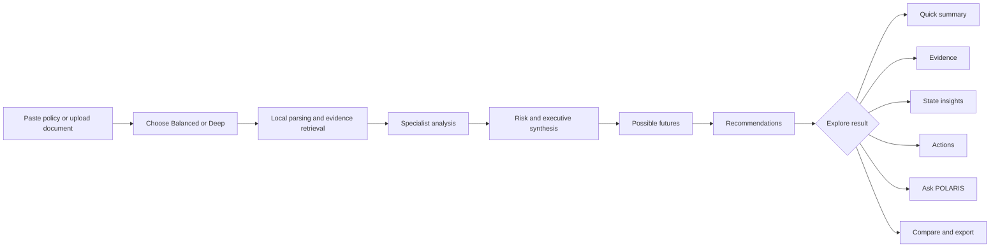
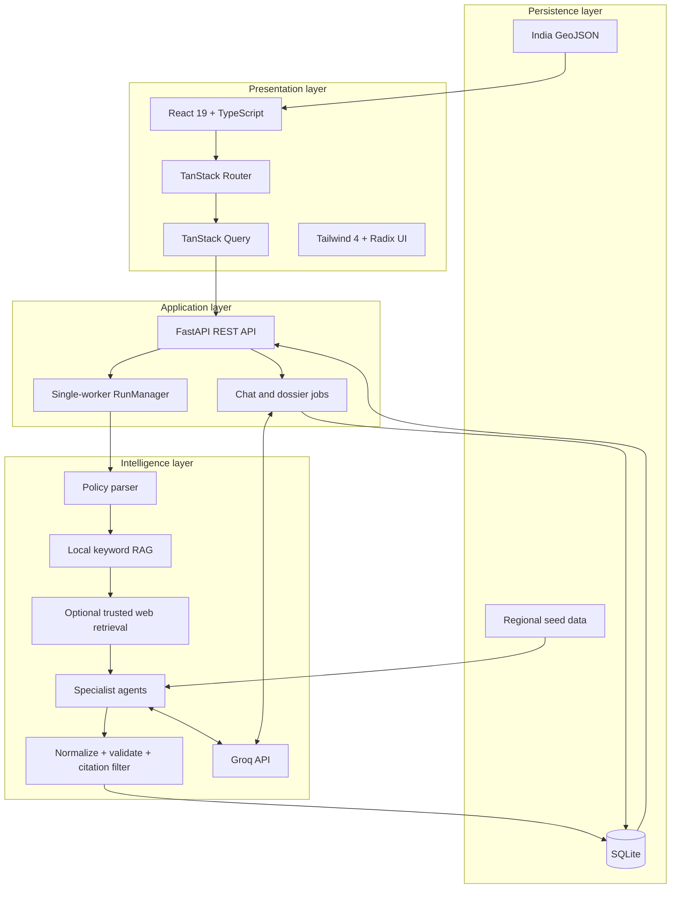
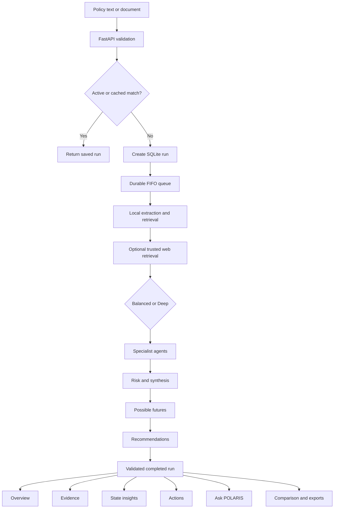

<div align="center">

# 🧭 POLARIS

### Multi-Agent Policy Intelligence for Evidence-Aware Public Decisions

**Turn policy documents into structured findings, traceable evidence, regional insight, realistic future scenarios, and actionable recommendations.**

[](https://react.dev/)
[](https://www.typescriptlang.org/)
[](https://fastapi.tiangolo.com/)
[](https://groq.com/)
[](https://sqlite.org/)
[](https://vite.dev/)
[](https://github.com/shiv0666/-polaris---multiagent-policy-analyzer)
[](https://github.com/shiv0666/-polaris---multiagent-policy-analyzer/commits/main)

[Explore Features](#-feature-tour) · [Understand the Architecture](#-architecture-at-a-glance) · [Run Locally](#run-locally) · [API Reference](#persistence-and-api) · [Project Handbook](#architecture-handbook)

</div>

---

## 🌍 What is POLARIS?

POLARIS is a full-stack, local-first policy analysis platform focused on Indian public policy. It accepts a policy proposal or document and coordinates specialized AI analysis across economic, environmental, social, legal, budgetary, risk, and implementation perspectives.

Instead of returning one opaque chatbot answer, POLARIS builds a durable analysis workspace. Each stage is structured, validated, saved, and connected to the evidence supplied to that stage. Users can review a concise brief, inspect specialist reasoning, open supporting passages, explore state-level relevance, ask grounded follow-up questions, compare saved policies, and export the result.

The active AI provider is **Groq only**. Documents are parsed locally. SQLite stores runs, partial checkpoints, evidence, telemetry, and follow-up histories.

> [!IMPORTANT]
> POLARIS provides AI-assisted decision support. Its impact scores, confidence values, scenarios, recommendations, and state weights are analytical estimates—not measured outcomes, official forecasts, legal advice, or proof of causality.

## 🎯 Problem statement

Public-policy material is usually long, fragmented, technical, and difficult to evaluate consistently. A decision-maker may need to understand economic effects, environmental consequences, social distribution, budget constraints, legal feasibility, execution risks, regional differences, and source quality at the same time.

Common analysis workflows create several problems:

- policy documents are summarized without preserving uncertainty;
- different impact domains are mixed into one generic answer;
- recommendations become reusable boilerplate instead of responding to the actual findings;
- citations are presented without a clear link to the context available to the model;
- long analyses fail when provider token or request limits are reached;
- partial work disappears after an error or restart;
- national conclusions are repeated as if they were state-specific facts;
- policy comparison requires manual reading across separate reports;
- nontechnical users cannot easily move between a quick brief and analytical detail.

## 💡 The POLARIS approach

POLARIS addresses those problems with a staged, evidence-aware architecture:

| Challenge                  | POLARIS response                                                                     |
| -------------------------- | ------------------------------------------------------------------------------------ |
| One-dimensional summaries  | Separate economic, environment, social, legal/budget, and risk perspectives          |
| Generic repeated actions   | Dedicated Groq recommendation stage grounded in completed findings                   |
| Repeated future narratives | Validated policy-specific possible futures with mechanisms and likelihood rationales |
| Weak source traceability   | Stable evidence catalog IDs and a claim-level evidence drawer                        |
| Long-document overflow     | Local extraction, chunk retrieval, compaction, and a hard request ceiling            |
| Provider rate limits       | Shared token reservation, request pacing, retry telemetry, and FIFO execution        |
| Lost work                  | Immediate stage checkpoints, cancellation safety, resume, and restart recovery       |
| Misleading regional claims | Relative state weights plus concise dossiers that must acknowledge missing evidence  |
| Complex output             | Quick summary and analyst-detail reading modes over the same saved result            |
| Isolated reports           | Searchable library, comparison workspace, Ask POLARIS, and safe exports              |

## 👥 Who is it for?

| Audience                               | How POLARIS helps                                                                       |
| -------------------------------------- | --------------------------------------------------------------------------------------- |
| **Policy researchers**                 | Structure a first-pass review and trace claims back to saved source passages            |
| **Government and public-sector teams** | Surface delivery risks, affected groups, budget questions, and monitoring needs         |
| **Think tanks and NGOs**               | Compare policy narratives across economic, social, environmental, and regional lenses   |
| **Students and academic teams**        | Study multi-agent orchestration, RAG, validation, and policy-analysis workflows         |
| **Journalists and civic analysts**     | Create an organized evidence map before deeper verification                             |
| **Developers**                         | Explore a production-style React/FastAPI AI system with durable jobs and quota controls |

## 🗺️ Target areas

POLARIS is designed around cross-domain public-policy questions, including:

- economic development, trade, investment, employment, and public finance;
- agriculture, rural livelihoods, income support, and food systems;
- energy transition, manufacturing, transport, climate, water, and pollution;
- health, education, housing, welfare access, and social inclusion;
- digital public infrastructure, innovation, regulation, and administrative delivery;
- legal authority, institutional coordination, compliance, and implementation capacity;
- state and union-territory exposure across India.

A domain hint can guide classification, but the parser and specialists use the supplied policy content as the authoritative analysis subject.

## ✨ Feature tour

### Input and research

- Paste up to **200,000 characters** of policy text.
- Upload **PDF, DOCX, TXT, Markdown, CSV, or JSON** files up to **10 MB**.
- Parse documents locally before model analysis.
- Drag and drop files with readable validation errors.
- Save text drafts locally in the browser.
- Enable or disable optional trusted-source web research.
- Reuse recent identical results or force a fresh analysis.

### Multi-agent analysis

- **Balanced mode:** four planned Groq calls with combined specialist work.
- **Deep mode:** eight planned Groq calls with four independent domain stages.
- Economic, environmental, social, legal/budget, and risk analysis.
- Executive verdict and six-section policy brief.
- Overall impact magnitude, risk level, confidence, and rationale.
- Structured metric directions, magnitudes, assumptions, and uncertainty.
- Validation repair for malformed or incomplete JSON.

### Evidence and transparency

- Local document passage retrieval.
- Optional bounded public web retrieval.
- Stable evidence IDs supplied per model call.
- Claim-level evidence drawer.
- Source excerpts, links, retrieval status, assumptions, uncertainty, and conflicts.
- Automatic removal of citation IDs that were not in the supplied catalog.
- Clear labeling of partial analysis and link-only sources.

### Decision workspace

- Quick summary for rapid reading.
- Analyst detail for specialists.
- Three differentiated possible futures.
- Dynamic policy-specific recommendations.
- Interactive India atlas with 36 states and union territories.
- Compact five-point state dossiers.
- Ask POLARIS grounded in the selected run.
- Searchable policy library.
- Two-policy comparison without another AI call.
- Text, complete JSON, and safe CSV exports.

### Reliability and UX

- Durable FIFO job queue.
- Queue position and real provider wait states.
- Token and API-request telemetry.
- Cancel, retry, resume, and restart recovery.
- Immediate checkpoint persistence.
- Background navigation with completion notifications.
- Responsive glassmorphic interface.
- Light and dark modes.
- Keyboard focus and reduced-motion support.
- Accessible empty, partial, offline, and error states.

## 🧭 User journey



## 🏗️ Architecture at a glance



### Core technology

| Layer     | Technology                                                              |
| --------- | ----------------------------------------------------------------------- |
| Frontend  | React 19, TypeScript 5, TanStack Start, TanStack Router, TanStack Query |
| UI        | Tailwind CSS 4, Radix UI, Lucide, Recharts, Sonner                      |
| Backend   | Python 3.11+, FastAPI, Uvicorn, Pydantic, HTTPX                         |
| AI        | Groq structured JSON generation with model fallbacks                    |
| Retrieval | Local keyword RAG and optional trusted-source web retrieval             |
| Documents | pypdf, python-docx, local UTF-8 extraction                              |
| Storage   | SQLite with durable JSON run payloads                                   |
| Build     | Vite 8 and Nitro                                                        |
| Testing   | TypeScript, ESLint, Prettier, SSR render checks, pytest                 |

## 🔍 What makes this project different?

### Evidence-aware rather than citation-decorated

Every model stage receives a bounded evidence catalog. Returned IDs are checked against that exact catalog. Unknown IDs are removed instead of silently mapped to unrelated sources.

### Durable rather than request-bound

Long-running work is queued in the backend and saved stage by stage. Closing a request, refreshing the page, navigating elsewhere, or restarting the backend does not automatically destroy completed findings.

### Quota-aware rather than retry-heavy

POLARIS estimates request size before dispatch, reserves tokens, serializes local work, respects provider wait headers, compacts repeated context, and exposes telemetry to the interface.

### Policy-specific rather than template-driven

Possible futures and recommendations are produced by dedicated Groq stages using the current policy’s parsed scope, specialist findings, risks, and evidence. Generic fallback cards are not presented as final analysis.

### Honest about geographic uncertainty

State views distinguish national inference, relative weights, direct source mentions, and missing local evidence. Dossiers are concise by design and cannot invent local statistics.

## 📊 Output model

A successful run produces:

```text
Policy input
├── Parsed policy profile
├── Retrieved document passages
├── Optional web sources
├── Evidence catalog
├── Specialist findings
│   ├── Economic
│   ├── Environmental
│   ├── Social
│   ├── Legal and budget
│   └── Risk
├── Executive synthesis
│   ├── Verdict
│   ├── Impact magnitude
│   ├── Risk level
│   ├── Confidence basis
│   └── Six-section brief
├── Three possible futures
├── Policy-specific recommendations
├── State exposure weights
└── Lifecycle and quota telemetry
```

## 📚 Documentation map

| If you want to…          | Read                                                                |
| ------------------------ | ------------------------------------------------------------------- |
| Start the app            | [Run locally](#run-locally)                                         |
| Understand API limits    | [Quota protection](#quota-protection)                               |
| Inspect evidence rules   | [Evidence and analytical quality](#evidence-and-analytical-quality) |
| Integrate with the API   | [Persistence and API](#persistence-and-api)                         |
| Run validation           | [Checks](#checks)                                                   |
| Understand every service | [Architecture handbook](#architecture-handbook)                     |
| Find a module            | [Complete module catalog](#complete-module-catalog)                 |
| Prepare a release        | [Operations guide](#operations-guide)                               |
| Review constraints       | [Remaining limits](#remaining-limits)                               |

---

## Run locally

Requirements: Node.js compatible with Vite 8 (the workspace was checked with Node 24), Python 3.11+, and a Groq API key.

```powershell
npm install
python -m pip install -r backend/requirements.txt
Copy-Item backend/.env.example backend/.env
```

Fill in `GROQ_API_KEY` in `backend/.env`. Preserve your existing configuration if that file already exists. ScrapingBee is optional; public retrieval works without it where sources allow access.

```powershell
powershell -ExecutionPolicy Bypass -File .\start-polaris.ps1
```

Frontend: http://127.0.0.1:8080  
Backend: http://127.0.0.1:8001  
API documentation: http://127.0.0.1:8001/docs

The startup script reuses already-running services. Restart an existing backend after changing Python code. A backend instance guard prevents accidentally running two independent local quota consumers.

Use `VITE_API_BASE_URL` when the frontend and backend are on different origins. API credentials remain in the backend and are never returned by the runtime endpoint.

## Quota protection

Existing token limits and environment overrides are retained. Default guardrails:

| Setting                         | Default | Purpose                                       |
| ------------------------------- | ------- | --------------------------------------------- |
| `GROQ_TOKENS_PER_MINUTE`        | 8000    | Configured provider token budget              |
| `GROQ_TPM_SAFETY_RATIO`         | 0.70    | Reserve tokenizer headroom                    |
| `GROQ_TOKEN_WINDOW_SECONDS`     | 65      | Conservative rolling window                   |
| `GROQ_MAX_REQUEST_TOKENS`       | 5500    | Estimated input plus maximum output ceiling   |
| `GROQ_REQUESTS_PER_MINUTE`      | 30      | Shared request pacing                         |
| `GROQ_REQUEST_SPACING`          | 0.75    | Minimum configured inter-call spacing         |
| `GROQ_BYTES_PER_TOKEN_ESTIMATE` | 2.0     | UTF-8 based conservative estimate             |
| `GROQ_TOKEN_BUDGET_SCOPE`       | shared  | Default account budget across model fallbacks |

The system serializes jobs and model calls, honors provider reset information and Retry-After, compacts repeated/secondary prompt content, and reconciles reserved tokens against returned usage. Long policy text is sampled across the document; the full document remains in SQLite/local retrieval. A request that cannot fit the configured ceiling fails locally rather than sending an oversized request.

Groq's remaining-request header refers to the daily request limit; token headers refer to the per-minute token limit. A non-exhausted daily reset is not treated as a mandatory pause. See [Groq's rate-limit documentation](https://console.groq.com/docs/rate-limits).

Quota telemetry in Preferences & system shows **local reservations**, not a provider account balance. API limits imposed by other applications sharing your account can still delay work.

Optional cache settings can shorten or disable reuse:

```env
POLARIS_WEB_CACHE_TTL_SECONDS=3600
POLARIS_DOCUMENT_CACHE_TTL_SECONDS=86400
```

Ask POLARIS and state dossiers each use one planned compact call, plus bounded validation/provider retries. Merely opening chat, browsing history, switching summary/detail, selecting states, comparing runs, or exporting reports makes no Groq calls.

## Evidence and analytical quality

New synthesis output includes a `brief` with six keys:

```json
{
  "policy": [],
  "benefits": [],
  "risks": [],
  "affected": [],
  "uncertainty": [],
  "actions": []
}
```

Each section contains concise claims:

```json
{
  "text": "A policy-specific finding",
  "kind": "ai_inference",
  "evidence_ids": ["doc-..."],
  "assumptions": [],
  "uncertainty": "What the available evidence does not establish",
  "conflicting_evidence_ids": []
}
```

Kinds distinguish document facts, external evidence, AI inferences, and user assumptions. Model classification is not independent fact verification. Invalid IDs are removed, not replaced by guessed sources. Model inputs treat policy text, external excerpts, prior responses, and user assumptions as untrusted data rather than instructions.

Metadata is shown only when actually available. Plain text/PDF extraction currently does not retain original document pagination; passage IDs are retrieval identifiers, not invented page numbers. Web publication dates appear only when provided in supported source metadata. A blocked or unreadable page remains a link-only reference and is not supplied as page-content evidence.

Older runs remain readable. They do not receive fabricated citations, new brief sections, or recommendations. Any later chat on an older run can cite the specific catalog supplied to that chat; this does not retroactively attach those citations to the original analysis.

Impact values are **0–100 magnitude indices**, not benefit percentages. A score of 1 stays 1/100. Confidence is model-assessed evidence support, not measured accuracy. Aggregate confidence is the arithmetic mean of four domain confidences and risk confidence. Scenario likelihoods must be finite, individually between 5 and 90, have rationales, and total 100; only minor rounding discrepancies are normalized.

## Persistence and API

The existing `backend/polaris.db` is preserved. Schema changes add a cache-key column/index; no history is dropped or rewritten. Chat/scenario jobs use the existing durable job storage, keyed by parent run and job kind, and are excluded from the main policy library. Completed checkpoints are saved with each policy.

| Method     | Endpoint                       | Behavior                                                     |
| ---------- | ------------------------------ | ------------------------------------------------------------ |
| GET        | `/api/health`                  | Service health                                               |
| GET        | `/api/runtime`                 | Safe queue, quota configuration, cache, and mode metadata    |
| POST       | `/api/runs`                    | Submit policy text or reuse an identical run                 |
| POST       | `/api/runs/upload`             | Extract and submit a document                                |
| GET        | `/api/runs?limit=100&offset=0` | Policy history without full policy text                      |
| GET        | `/api/runs/{id}`               | Saved findings, stages, evidence, and current queue position |
| POST       | `/api/runs/{id}/cancel`        | Cancel while preserving partial findings                     |
| GET / POST | `/api/runs/{id}/chat`          | List saved chat exchanges / queue a question                 |
| GET / POST | `/api/runs/{id}/scenarios`     | List variants / queue assumption reanalysis                  |
| GET        | `/api/jobs/{id}`               | Inspect a chat or scenario job                               |
| POST       | `/api/jobs/{id}/cancel`        | Cancel a chat/scenario job                                   |
| POST       | `/api/jobs/{id}/retry`         | Retry a failed/cancelled chat/scenario job                   |
| PATCH      | `/api/scenarios/{id}`          | Rename a variant                                             |
| DELETE     | `/api/scenarios/{id}`          | Cancel if necessary and delete a variant                     |

Create an analysis:

```json
{
  "policy_text": "Your policy proposal",
  "domain_hint": null,
  "web_enabled": true,
  "analysis_mode": "balanced",
  "force_refresh": false
}
```

Response includes `run_id`, `reused`, `reuse_reason` (active/cached/null), and `queue_position`. Position 0 is active; positive positions are queued; null means no live queue entry. Upload accepts the same options as multipart fields.

Chat POST: `{ "question": "...", "request_id": "client-generated-UUID" }`.  
Scenario POST: `{ "title": "...", "assumptions": {"Funding adequacy": "Funding constrained"}, "notes": "...", "request_id": "client-generated-UUID" }`.  
Rename PATCH: `{ "title": "New variant name" }`.

Request IDs make retries idempotent. One active chat reply per policy prevents accidental overlapping follow-ups. HTTP errors return readable details to the frontend.

## Checks

```powershell
python -m pip install -r backend/requirements-dev.txt
npm run typecheck
npm run lint
npm test
npm run build
```

The backend tests use temporary databases and mocked providers. They cover quota pacing, bounded requests, 4/8-call modes, local document parsing, immediate stage persistence, checkpoint recovery, cache separation and expiry, cancellation, source-ID validation, scenario validation, and workspace persistence.

The frontend test renders seven run states plus partial findings and old analyses using React server rendering. It checks six-section summaries, safe exports, citation identifiers, and initial input controls. This is not a substitute for interactive browser/accessibility testing.

Groq is the only supported model provider. Browser automation may still be needed for a full visual and accessibility QA pass.

## Remaining limits

- This is a local/shared workspace without authentication or per-user authorization. Do not expose the backend publicly as a multi-tenant service.
- Geographic weights still use illustrative, unsourced seed data. They are clearly labeled heuristic exposure, not empirical state effects. The bundled atlas has 36 regions, separate Telangana, Jammu and Kashmir, and Ladakh. It follows an Indian claimed-boundary depiction; disputed areas are labeled. Source provenance is in `src/data/india-map-sources.md`.
- Retrieval is lightweight keyword-based RAG, not a calibrated economic/legal model. Source allowlisting and valid citation IDs do not prove factual correctness.
- Uploaded files must be PDF, DOCX, TXT, MD, CSV, or JSON, at most 10 MB, with no more than 200,000 extracted characters. Scanned PDFs need OCR before upload.
- Chat can still wait behind the current analysis or the provider's quota window. Possible futures and state dossiers use compact, bounded Groq requests.
- The comparison picker currently loads up to 500 recent analyses. Use Load more analyses in the policy library, or the history API's pagination, for older records.
- A client draft is stored locally; files must be selected again after refreshing the input form. Saved runs and conversations live in the backend, not in browser storage.

## Main implementation files

Backend: `main.py`, `run_manager.py`, `db.py`, `run_cache.py`, `pipeline.py`, `groq_client.py`, `evidence.py`, `workspace.py`, `json_util.py`, and `web_retriever.py`.

Frontend: `src/routes/index.tsx`, `src/lib/polaris-api.ts`, and the POLARIS components: PolicyForm, RunProgress, DetailedDashboard, QuickSummary, EvidenceDrawer, AskPolaris, StateInsights, IndiaMap, ComparisonWorkspace, RunHistory, Sidebar, TopBar, and SettingsPanel.

The Lovable integration rule still applies: do not rewrite published Git history. No deployment or push is needed to run this workspace locally.

The `Resume analysis` button calls `POST /api/runs/{run_id}/resume` for failed or cancelled analyses. Saved successful checkpoints are reused. Validation repair avoids duplicating the system instructions and discards an invalid prior completion when necessary to fit the unchanged 5,500-token ceiling, preserving the grounding context instead. Balanced synthesis explicitly includes the six-section brief in its output schema.

### Regional explorer

The atlas offers keyboard-selectable regions, flat/3D-style relief, zoom/reset, search, domain weights, saved source mentions, and national domain context. Selection and browsing make no model calls. `Generate state dossier` queues a bounded, source-grounded follow-up through the existing worker; stable request IDs reuse each state's saved answer. Dossiers distinguish regional evidence from national inference and cover rural/urban eligibility, affected groups, implementation risks, actions, and monitoring gaps. They do not fetch new regional statistics or claim to be empirical state forecasts.

---

## Architecture handbook

### Request-to-result topology



### Pipeline stage matrix

| Stage           | Input                         | Processing                                | Saved output              | Failure behavior            |
| --------------- | ----------------------------- | ----------------------------------------- | ------------------------- | --------------------------- |
| Submission      | Text or multipart file        | Validate, normalize, calculate cache key  | Initial run               | Readable HTTP error         |
| Parsing         | Compacted policy              | Structured classification                 | `parsed_policy`           | Run stops safely            |
| Retrieval       | Full saved policy             | Chunk scoring and optional web retrieval  | Context, sources, catalog | Local context remains       |
| Specialists     | Scope and evidence            | Combined Balanced or four Deep calls      | Four domain outputs       | Valid checkpoints remain    |
| Risk            | Specialist signals            | Structured risk assessment                | Risk output               | Domain results remain       |
| Synthesis       | Domain and risk outputs       | Verdict and six-section brief             | `synthesis`               | Earlier work remains        |
| Scenarios       | Findings, risk, evidence      | Groq possible-future generation           | `scenario_set`            | Resume reruns missing stage |
| Recommendations | Findings, scenarios, evidence | Groq action generation                    | `recommendations`         | Resume reruns missing stage |
| Completion      | Validated outputs             | Regional aggregation and lifecycle update | Final run                 | Terminal state persists     |

### Frontend state flow

TanStack Query owns remote state. The root route polls runtime metadata every 15 seconds and active runs more frequently while needed. Terminal runs stop polling. The selected run is synchronized to the URL and session storage. A separately tracked active run enables background browsing and completion notifications.

`src/lib/polaris-api.ts` contains typed run, agent, evidence, scenario, recommendation, runtime, and workspace-job contracts. It also owns API-base resolution, JSON and multipart transport, network errors, status helpers, and all frontend endpoint functions.

### Backend execution flow

`backend/main.py` owns HTTP concerns, `RunManager` owns scheduling, `pipeline.py` owns core analysis, and `workspace.py` owns follow-up jobs. Submission returns immediately after the run is committed and queued. The browser polls the saved representation, so page refresh and navigation do not control job lifetime.

### Structured-output contract

Every analytical model response is JSON. A traced claim has this shape:

```json
{
  "text": "Policy-specific conclusion",
  "kind": "ai_inference",
  "evidence_ids": ["doc-123"],
  "assumptions": [],
  "uncertainty": "What the supplied material does not establish",
  "conflicting_evidence_ids": []
}
```

The six-section brief always uses `policy`, `benefits`, `risks`, `affected`, `uncertainty`, and `actions`.

Specialists can return reasoning, metric effects, direction, magnitude, confidence, evidence, assumptions, uncertainty, and affected-state weights. Raw metric identifiers are never substituted for complete recommendations.

### Scenario and recommendation integrity

Possible futures are generated during the core pipeline from the real saved policy, specialist findings, risk, and evidence. Validation requires differentiated content, outcome points, likelihoods, and rationales. The visible product has no What-if tab; compatibility routes remain only for older saved job data.

Recommendations run after the earlier analysis is available. Validation requires at least three substantive policy-specific actions with a title, description, reason, priority, supporting signals, and trace fields.

### Regional boundaries

Map selection and browsing are local. Values represent relative model weights, not measured impact. A state dossier sends one compact request containing the selected state, two goals, saved domain weights, a small metric set, risk context, and at most two passages that name the state. Its answer must contain exactly five short points: Exposure, Likely effect, Main risk, State action, and Data needed.

### Reliability layers

1. Pydantic validates inbound requests.
2. File and policy limits reject invalid inputs early.
3. Cache keys prevent redundant work.
4. A submission lock blocks duplicate scheduling.
5. A backend instance guard prevents two local quota consumers.
6. One FIFO worker serializes provider work.
7. Token reservations and pacing protect rate limits.
8. Prompt compaction bounds requests.
9. Normalizers handle safe representation differences.
10. Validators reject incomplete output.
11. Citation filters remove unknown source IDs.
12. Stage checkpoints preserve completed work.
13. Terminal-state guards block late writes.
14. Startup recovery re-enqueues unfinished jobs.
15. Partial UI states keep saved results readable.

## Complete module catalog

### Product UI

| File                                   | Role                                                       |
| -------------------------------------- | ---------------------------------------------------------- |
| `PolicyForm.tsx`                       | Submission, uploads, examples, modes, drafts, validation   |
| `RunProgress.tsx`                      | Six-section progress, queue, timings, tokens, cancellation |
| `DetailedDashboard.tsx`                | Overview, Evidence, State insights, Actions                |
| `QuickSummary.tsx`                     | Six-section executive reading mode                         |
| `KpiHeader.tsx`                        | Impact, risk, confidence                                   |
| `EvidenceDrawer.tsx`                   | Sources, assumptions, uncertainty, conflicts               |
| `IndiaMap.tsx`                         | GeoJSON, selection, keyboard control, zoom, relief         |
| `StateInsights.tsx`                    | State search, weights, context, dossiers                   |
| `AskPolaris.tsx`                       | Follow-up chat, persistence, retry, cancel                 |
| `RunHistory.tsx`                       | Search, pagination, status, reopening                      |
| `ComparisonWorkspace.tsx`              | Two-policy saved-result comparison                         |
| `Sidebar.tsx` and `TopBar.tsx`         | Navigation, connection, responsive theme                   |
| `SettingsPanel.tsx`                    | Safe provider, queue, cache, and quota visibility          |
| `JobStatus.tsx`                        | Workspace-job progress                                     |
| `AgentPanel.tsx` and `VerdictCard.tsx` | Reusable result summaries                                  |

### Frontend libraries

| File                                   | Role                                                      |
| -------------------------------------- | --------------------------------------------------------- |
| `polaris-api.ts`                       | API contracts and transport                               |
| `brief-sections.ts`                    | Canonical brief ordering                                  |
| `report-export.ts`                     | Text, JSON, safe CSV                                      |
| `state-geography.ts`                   | State aliases and normalization                           |
| `policy-templates.ts`                  | Editable illustrative examples                            |
| `error-capture.ts` and `error-page.ts` | Bounded error handling                                    |
| `styles.css`                           | Glass design system, themes, depth, motion, accessibility |

### Backend services

| File               | Role                                         |
| ------------------ | -------------------------------------------- |
| `main.py`          | FastAPI lifecycle, uploads, policy endpoints |
| `models.py`        | Pydantic contracts, statuses, limits         |
| `pipeline.py`      | Multi-stage analysis                         |
| `groq_client.py`   | Groq transport, fallback, retry, quota       |
| `prompts.py`       | Active agent instructions                    |
| `json_util.py`     | Output normalization                         |
| `evidence.py`      | Catalog and citation rules                   |
| `rag.py`           | Chunking, retrieval, compaction              |
| `web_retriever.py` | Trusted-source retrieval                     |
| `run_manager.py`   | Durable FIFO, cancel, recovery               |
| `run_cache.py`     | Cache revision, keys, TTL                    |
| `workspace.py`     | Chat, dossier, compatibility jobs            |
| `db.py`            | SQLite and atomic updates                    |
| `worldbank.py`     | Supporting public-indicator helpers          |

## Operations guide

### Local data that must stay untracked

- `backend/.env` and `backend/.env.local`
- `backend/polaris.db`
- `.runtime/`, `.output/`, and `.wrangler/`
- `node_modules/`
- Python virtual environments, caches, and bytecode

### Runtime logs

The Windows launcher writes frontend and backend stdout/stderr logs under `.runtime`. Inspect those files first when a service fails to start.

### Release checklist

- [ ] No real credentials are staged.
- [ ] `npm run typecheck` passes.
- [ ] `npm run lint` has no errors.
- [ ] Frontend and backend tests pass.
- [ ] `npm run build` succeeds.
- [ ] Text and every supported upload format are handled.
- [ ] Balanced and Deep runs complete.
- [ ] Partial, error, cancel, and resume states render.
- [ ] Possible futures differ and include rationales.
- [ ] Recommendations are policy-specific.
- [ ] Evidence IDs open valid catalog entries.
- [ ] State selection and dossier generation work.
- [ ] Ask POLARIS reloads saved history.
- [ ] Text, JSON, and CSV exports open safely.
- [ ] Light, dark, desktop, and mobile layouts remain readable.

## A–Z project index

| Letter | Project concept                                                         |
| ------ | ----------------------------------------------------------------------- |
| A      | Agents, Actions, Ask POLARIS, accessibility                             |
| B      | Balanced mode, background navigation                                    |
| C      | Cache, cancellation, checkpoints, citations, comparison                 |
| D      | Deep mode, documents, durable data                                      |
| E      | Evidence, exports, error recovery                                       |
| F      | FastAPI, FIFO, frontend state                                           |
| G      | Groq-only generation, geographic weights                                |
| H      | History, health, human review                                           |
| I      | India atlas, impact index, idempotency                                  |
| J      | JSON validation, jobs                                                   |
| K      | Keyword retrieval, known limits                                         |
| L      | Local-first storage, light/dark layouts                                 |
| M      | Multi-agent pipeline, models, metrics                                   |
| N      | Normalization, navigation, network states                               |
| O      | Overview, operational telemetry                                         |
| P      | Parser, partial results, prompts, persistence                           |
| Q      | Quota protection, queue positions                                       |
| R      | Recommendations, RAG, retries, resume, regions                          |
| S      | Scenarios, specialists, dossiers, SQLite, security                      |
| T      | TanStack, telemetry, token ceiling, TypeScript                          |
| U      | Uploads, uncertainty, user preferences                                  |
| V      | Validation, Vite, visual system                                         |
| W      | Web retrieval, workspace jobs                                           |
| X      | Export safety for spreadsheet content                                   |
| Y      | Yielded partial results after interruption                              |
| Z      | Zero extra AI calls for browsing, comparison, exports, and view changes |
